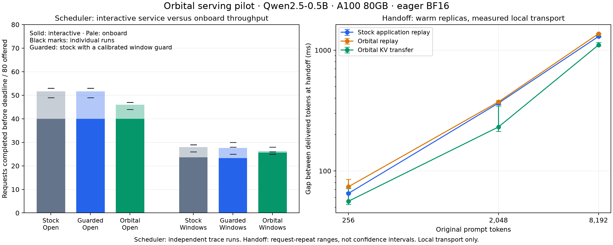

# Scheduler and handoff experiments on two A100 GPUs

Measured on 2026-11-10. The first campaign completed **18 scheduler runs** and
**33 handoff trials across 11 configurations**. This is a descriptive pilot:
orbital scheduling improved interactive latency and some interactive deadline
outcomes, while reducing onboard throughput. KV transfer reduced the median
local handoff interruption relative to application replay in the tested cases.
These results do not establish a general constellation throughput advantage.



## Fixed environment and comparison

- Two A100 80GB PCIe GPUs; driver 570.195.03; CUDA compatibility runtime 13.0;
  PyTorch 2.14.0+cu130; NCCL 2.30.7; Python 3.12.3.
- Immutable upstream source: `8f2ba935a5cb82f5fc231eea6b687a87443e88a6`.
- Orbital runtime: `12b28fdd4c1775bed8a4a1fca1fb090e5a13ee5e`.
- Qwen/Qwen2.5-0.5B-Instruct revision
  `7ae557604adf67be50417f59c2c2f167def9a775`.
- TP=1, BF16, eager synchronous execution, chunked prefill, no prefix cache,
  128 batch tokens, eight active sequences, maximum model length 12,288,
  25% GPU memory allocation, batch invariance enabled, greedy generation.
- The stock workers import the separate upstream worktree. Both trees use the
  same installed dependencies and compiled extensions. A missing generated
  FlashMLA wrapper in the baseline worktree was supplied from that same runtime
  before any measured campaign run; no upstream algorithm was patched.
- Workers run in separate processes. The campaign runs configurations serially,
  checks for existing GPU processes, and randomizes comparison order with a
  recorded seed. Model loading, reference generation, and warmup precede timing.

See [environment](experiments/20261110/environment.json),
[execution plan](experiments/20261110/pilot-v1/plan.json), and
[summary with individual-run values](experiments/20261110/summary.json).

## Scheduler: faster interactive service, lower onboard throughput

Each run offers 80 requests over a 16-second horizon. Forty interactive requests
have 256-token prompts, 32-token output limits, priority zero, and two-second
deadlines. Forty onboard requests have 2,048-token prompts, 128-token output
limits, priority one, and six-second deadlines. Deadlines are capped at the
measurement horizon. Arrivals are predetermined from one of three seeds; a slow
engine does not receive less offered traffic.

The always-open control permits computation throughout. The windowed scenario
permits computation during `[0,4)`, `[6.4,10.4)`, and `[12.8,16)` seconds.
These are synthetic compute windows replayed at real time, not physical eclipse
or ground-contact predictions. All modes retain resident KV during closure and
cancel expired requests. Stock also receives identical priority metadata.

The stronger stock baseline adds a calibrated 26.8 ms closing-window guard.
Orbital uses the same calibration data for its batch-level policy. The profile
is an additive estimate calibrated on single-request prefill/decode timings;
it is not a guarantee across all mixed-batch shapes. Resource energy/power
ceilings are permissive in this pilot, so this is not a battery-budget study.

### Windowed scenario

Completion counts below are totals across three runs: 120 offered requests per
class, 240 overall. TTFT is the median of the three per-run interactive medians,
conditional on receiving a first token. Missing first tokens remain failures
in completion counts and are not assigned zero latency.

| Mode | Interactive on time / 120 | Onboard on time / 120 | Total on time / 240 | Interactive TTFT |
| --- | ---: | ---: | ---: | ---: |
| Stock + pause/keep gate | 71 | 13 | 84 | 386.9 ms |
| Stock + gate + guard | 70 | 13 | 83 | 391.7 ms |
| Orbital + same gate | 77 | 2 | 79 | 81.7 ms |

Against guarded stock, orbital reduced the reported interactive median TTFT by
79.1% and completed 10% more interactive requests. It completed **4.8% fewer
requests overall**, because onboard completions fell from 13 to two.
Individual total counts were `[26,28,25]` for orbital and `[28,25,30]` for guarded
stock. The paired differences have mixed signs; a universal goodput win is not
supported.

### Always-open control

All modes completed all 120 interactive requests. Orbital completed 18 onboard
requests versus 35 for each stock mode: totals of **138 versus 155**.
Interactive TTFT was 73.9 ms for orbital, 257.0 ms for guarded stock, and
266.6 ms for unguarded stock. The latency/throughput tradeoff therefore exists
even without compute-window closures.

The step traces provide evidence of recomputation. In the first always-open
orbital run, five requests entered prefill after decoding had already begun,
and observed prefill work exceeded original prompt lengths by at least 12,429
tokens. Guarded stock showed neither pattern. This supports preemption and
recomputation as a contributor to the lost onboard throughput. It is not a
complete causal decomposition of all runtime overhead.

Orbital also had 1.2–10.0 ms of measured step-wall-time overlap with closed
windows per windowed run. Unguarded stock had 22.7–28.2 ms; guarded stock had
zero in these runs. These are whole-step wall times, not isolated GPU kernel
durations. The predictive estimates did not provide a hard boundary guarantee.
Whole-device energy was similar between configurations; these results do not
establish better energy per useful completion for orbital.

## Handoff: measured local recovery costs

Both GPUs hold warm replicas. After 16 generated tokens of a 64-token request,
the harness begins a planned source inference suspension. The source remains
reachable for checkpoint/export; this is **not abrupt power loss**. Every mode
journals output before delivery. Original output limits and exact greedy tokens
must be preserved.

Stock application replay sends the original prompt plus already delivered
tokens to the target and generates only the remaining allowance. Orbital replay
uses the durable ownership protocol and reconstructs KV. Orbital transfer uses
the same protocol and copies compatible KV. Its scheduler has permissive budgets
so resource-window policy does not drive this comparison.

Each table entry is the median of three requests in one fresh engine pair.
Ranges are request-repeat ranges, **not confidence intervals** or independent
engine-launch replication. All measured gaps include the actual journal,
serialization, local IPC, GPU copies, and first destination token.

| Prompt tokens | Stock replay gap | Orbital replay gap | Orbital KV gap | KV image | Median KV gap reduction vs stock replay |
| --- | ---: | ---: | ---: | ---: | ---: |
| 256 | 65.2 ms | 73.9 ms | 56.1 ms | 3.75 MiB | 13.9% |
| 2,048 | 364.5 ms | 373.4 ms | 231.3 ms | 24.75 MiB | 36.5% |
| 8,192 | 1,300.0 ms | 1,369.0 ms | 1,105.0 ms | 96.75 MiB | 15.0% |

KV ranges were 52.8–71.7 ms, 212.1–345.4 ms, and 1,088.9–1,161.1 ms,
respectively. The small-context range overlaps stock replay's 64.9–66.3 ms
range, so its median difference needs further independent replication.

At 2,048 prompt tokens, restarting the original request had a 683.9 ms median
gap; waiting for the configured two-second suspension had a 2,025.3 ms gap.
Restart suppresses and verifies regenerated tokens already delivered to the
client. No duplicate tokens are credited as progress.

The state images stayed below the existing 256 MiB-per-rank cap. The reported
image bytes count the image once, not every control-plane traversal. There is
**no ISL bandwidth/delay emulation** here: adding a slow link may erase or reverse
the local transfer advantage. Orbital replay itself was slightly slower than
stock application replay, consistent with additional ownership-protocol work.

## Correctness, artifacts, and reproducibility

Every generated scheduler prefix matched its greedy reference. All 33 handoff
trials matched the reference's complete 64-token sequence and original limit;
the analyzer also checks reference hashes across modes. Orbital handoffs check
stale-owner rejection and idempotent retry after completion.

Separate post-campaign runs inject a lost successful activation reply for both
replay and transfer, and test a completely closed compute trace. Their results
and the component/GPU regression results are recorded in
[validation.json](experiments/20261110/validation.json). Fault runs are excluded
from the performance tables.

Validation passed: **80 unique local component/harness tests, nine real-GPU
regression tests, six lost-reply trials, and two closed-window controls**.
The full local suite had 79 tests; the final 12-test harness suite includes one
additional compressed-artifact regression. These overlapping suites contain
80 unique cases. Both A100s were idle after the tests finished.

Each run retains its result, manifest, worker options, and source identity under
`experiments/20261110/`. Scheduler events are losslessly compressed as
`events.jsonl.gz`. The exact executed pilot harness is archived as
`harness-v1.tar.gz`; hashes match the run manifests. The subsequent validation
harness is archived as `harness-v2.tar.gz`. It adds input/resume checks, support
for an empty compute-window list, and explicit lost-reply injection. The runtime
serving algorithms were unchanged throughout the campaign.

The current entry points and trace contract are documented in
[orbital_serving.md](../../docs/design/orbital_serving.md#scheduler-and-handoff-experiment-harness).
To regenerate the aggregate and figure from retained artifacts:

```bash
PYTHONPATH=. .venv/bin/python benchmarks/satellite/summarize_experiments.py \
  benchmarks/satellite/experiments/20261110/pilot-v1 \
  --output /tmp/orbital-summary.json
MPLCONFIGDIR=/tmp/orbital-matplotlib .venv/bin/python \
  benchmarks/satellite/plot_experiments.py \
  /tmp/orbital-summary.json /tmp/orbital-pilot.png
```

The plotting command requires matplotlib in the chosen analysis environment.

## Next experiments justified by these results

1. Measure a scheduler policy that accounts for preemption/recomputation cost;
   retain the interactive latency gains while quantifying the onboard tradeoff.
2. Connect actual handoff bytes to XeoVerse network replay, including shared-link
   capacity and ground delivery. Find the measured transfer/replay crossover.
3. Expand to larger supported models, different offered loads, forecast errors,
   and more independent engine launches. Include production-tuned stock with its
   supported CUDA graph and asynchronous optimizations as a separate baseline.

This pilot does not test spacecraft power protection, replicated authority
availability, abrupt pre-checkpoint source loss, cold model placement, HTTP
session migration, or the communication selector under moving ISLs.
