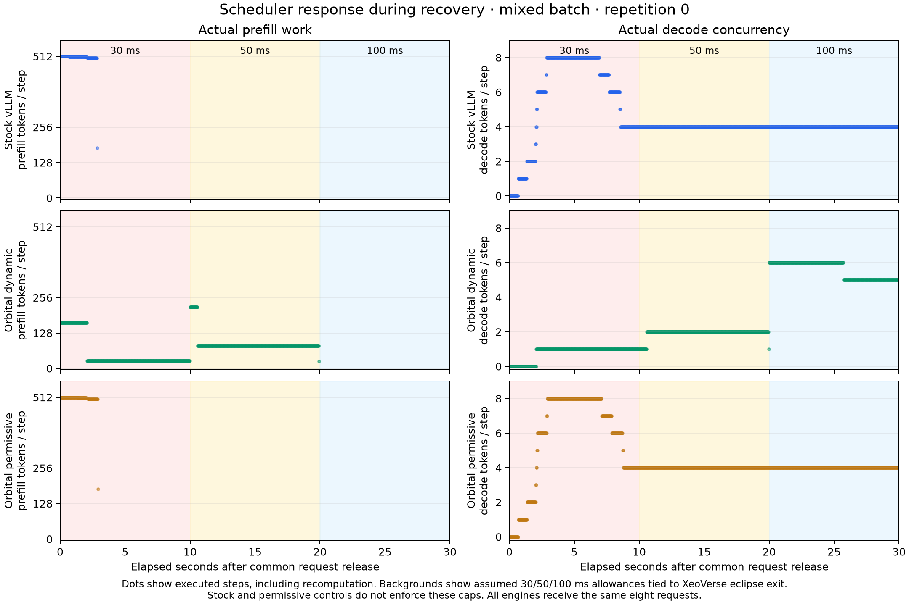
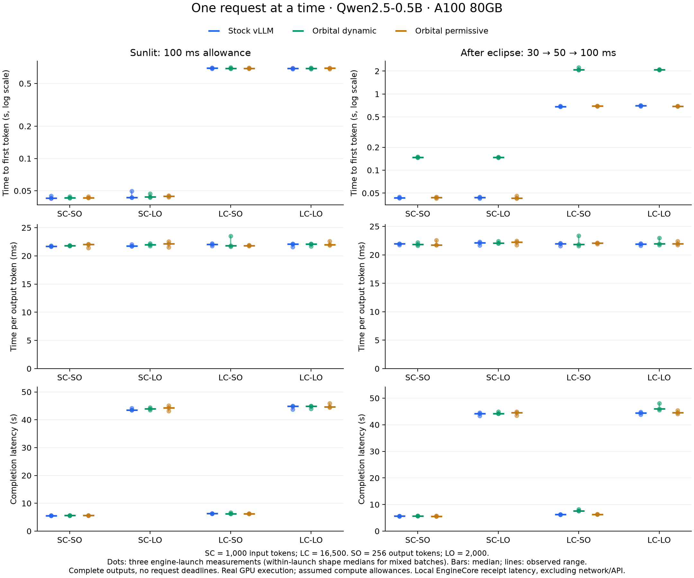
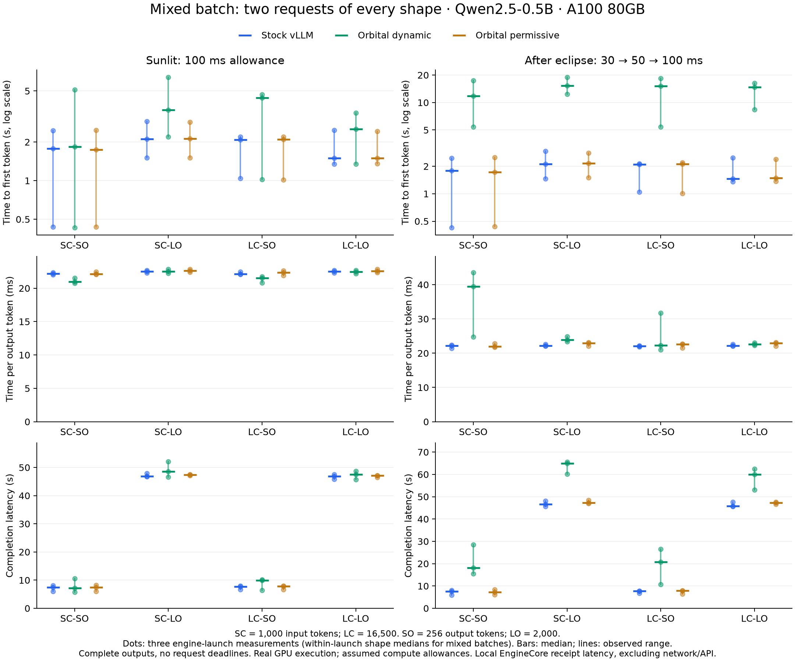

# Scheduler experiments by input and output length

This experiment compares immutable upstream vLLM, the existing orbital scheduler,
and the orbital scheduler with a permissive step budget. It runs real inference
on one A100 using orbital timing exported from XeoVerse. Handoff and collective
selection are inactive. The serving implementation is unchanged during the study.

## Measured results

The campaign completed on **2026-11-10**: **90 cases, 216 requests, and 243,648
output tokens**, across nine measured engine launches. Every request completed
its full output and matched the immutable stock reference. No watchdog fired.

The dynamic scheduler did not show an overall latency advantage on this model
and A100 configuration. Isolated steady-sunlight performance was similar to
stock. During recovery, smaller prefill chunks increased first-token latency;
in mixed batches, conservative decode limits added queueing delay.

Entire mixed-batch completion times, in seconds, are medians across the three
launches. Each batch contains two requests of each shape, with 9,024 output tokens:

| Condition | Stock | Dynamic | Permissive control | Dynamic versus stock |
| --- | ---: | ---: | ---: | ---: |
| Sunlit | 47.97 | 52.29 | 47.61 | 9.0% longer |
| Recovery | 47.12 | 65.65 | 48.50 | 39.3% longer |

The permissive control stays close to stock, pointing to the resource-budget
decisions as the main performance problem here. Some short requests already
in the batch decode faster at reduced concurrency: in steady sunlight, the
SC-SO median TPOT was 20.96 ms for dynamic scheduling and 22.19 ms for stock.
That descriptive improvement does not offset the extra waiting elsewhere in
the batch. Submission order materially changes individual request outcomes.

### Why the dynamic policy is slower here

All three configurations had **zero observed step-budget overruns**,
**zero preemptions**, and **zero recomputed token work** across this campaign.
The dynamic policy therefore did not deliver an observed budget-compliance
advantage on these workloads. This remains a measurement, not a hard real-time
guarantee for future executions.

In repetition zero, isolated LC-SO recovery used 100 dynamic prefill steps
with a maximum chunk of 166 tokens, compared with 33 stock steps and a maximum
of 512. Stock already uses chunked prefill; the added orbital behavior shrinks
its work allowance based on the supplied forecast.

In the stock recovery mixed batch of repetition zero, **182 pure decode steps
with eight sequences took a median 21.95 ms** (95th percentile 22.29 ms).
The additive profile predicted **127.67 ms** for that same batch. Its conservative
per-sequence addition limits decode work to one token at 30 ms, two at 50 ms,
and six at 100 ms even though the measured eight-sequence batch fit in 30 ms.
This is direct evidence that the cost model needs batch-aware calibration.
The policy and profile algorithm were kept unchanged throughout the campaign.



### Latency tables

Values below are medians across three engine launches. Mixed cases first take
the median of the two requests of each shape within a launch. Metrics are
aggregated separately, so the displayed medians need not satisfy the per-request
TTFT-plus-decode-time identity. Exact per-request timings and per-launch ranges
are retained in [the numerical summary](experiments/shapes-20261110/summary.json).
Three launch replicates provide descriptive ranges, not confidence intervals.

#### Isolated requests



##### Steady sunlight: isolated requests

| Shape | Configuration | TTFT (s) | TPOT (ms/token) | Completion (s) |
| --- | --- | ---: | ---: | ---: |
| SC-SO | Stock vLLM | 0.043 | 21.72 | 5.581 |
| SC-SO | Orbital dynamic | 0.043 | 21.82 | 5.606 |
| SC-SO | Orbital permissive | 0.043 | 22.06 | 5.670 |
| SC-LO | Stock vLLM | 0.043 | 21.76 | 43.532 |
| SC-LO | Orbital dynamic | 0.044 | 21.96 | 43.932 |
| SC-LO | Orbital permissive | 0.045 | 22.16 | 44.343 |
| LC-SO | Stock vLLM | 0.698 | 22.06 | 6.324 |
| LC-SO | Orbital dynamic | 0.692 | 21.79 | 6.248 |
| LC-SO | Orbital permissive | 0.692 | 21.80 | 6.248 |
| LC-LO | Stock vLLM | 0.690 | 22.10 | 44.880 |
| LC-LO | Orbital dynamic | 0.693 | 22.08 | 44.834 |
| LC-LO | Orbital permissive | 0.695 | 21.99 | 44.654 |

##### Recovery after eclipse: isolated requests

| Shape | Configuration | TTFT (s) | TPOT (ms/token) | Completion (s) |
| --- | --- | ---: | ---: | ---: |
| SC-SO | Stock vLLM | 0.043 | 21.96 | 5.646 |
| SC-SO | Orbital dynamic | 0.147 | 21.86 | 5.722 |
| SC-SO | Orbital permissive | 0.044 | 21.76 | 5.591 |
| SC-LO | Stock vLLM | 0.044 | 22.10 | 44.229 |
| SC-LO | Orbital dynamic | 0.148 | 22.05 | 44.222 |
| SC-LO | Orbital permissive | 0.043 | 22.26 | 44.551 |
| LC-SO | Stock vLLM | 0.685 | 21.98 | 6.304 |
| LC-SO | Orbital dynamic | 2.088 | 21.85 | 7.661 |
| LC-SO | Orbital permissive | 0.700 | 22.08 | 6.331 |
| LC-LO | Stock vLLM | 0.703 | 21.90 | 44.476 |
| LC-LO | Orbital dynamic | 2.093 | 21.96 | 45.992 |
| LC-LO | Orbital permissive | 0.693 | 21.95 | 44.577 |

#### Eight-request mixed batches



##### Steady sunlight: mixed batches

| Shape | Configuration | TTFT (s) | TPOT (ms/token) | Completion (s) |
| --- | --- | ---: | ---: | ---: |
| SC-SO | Stock vLLM | 1.777 | 22.19 | 7.484 |
| SC-SO | Orbital dynamic | 1.834 | 20.96 | 7.178 |
| SC-SO | Orbital permissive | 1.741 | 22.15 | 7.388 |
| SC-LO | Stock vLLM | 2.112 | 22.53 | 46.836 |
| SC-LO | Orbital dynamic | 3.549 | 22.51 | 48.544 |
| SC-LO | Orbital permissive | 2.130 | 22.63 | 47.376 |
| LC-SO | Stock vLLM | 2.086 | 22.16 | 7.713 |
| LC-SO | Orbital dynamic | 4.428 | 21.50 | 9.978 |
| LC-SO | Orbital permissive | 2.103 | 22.36 | 7.804 |
| LC-LO | Stock vLLM | 1.498 | 22.52 | 46.834 |
| LC-LO | Orbital dynamic | 2.529 | 22.48 | 47.463 |
| LC-LO | Orbital permissive | 1.496 | 22.59 | 47.130 |

##### Recovery after eclipse: mixed batches

| Shape | Configuration | TTFT (s) | TPOT (ms/token) | Completion (s) |
| --- | --- | ---: | ---: | ---: |
| SC-SO | Stock vLLM | 1.790 | 22.21 | 7.504 |
| SC-SO | Orbital dynamic | 11.840 | 39.48 | 18.142 |
| SC-SO | Orbital permissive | 1.722 | 21.99 | 7.262 |
| SC-LO | Stock vLLM | 2.122 | 22.23 | 46.558 |
| SC-LO | Orbital dynamic | 15.362 | 23.93 | 64.970 |
| SC-LO | Orbital permissive | 2.154 | 22.95 | 47.374 |
| LC-SO | Stock vLLM | 2.091 | 22.10 | 7.723 |
| LC-SO | Orbital dynamic | 15.135 | 22.24 | 20.805 |
| LC-SO | Orbital permissive | 2.124 | 22.58 | 7.926 |
| LC-LO | Stock vLLM | 1.458 | 22.20 | 45.736 |
| LC-LO | Orbital dynamic | 14.786 | 22.63 | 60.025 |
| LC-LO | Orbital permissive | 1.493 | 22.95 | 47.371 |

## Workloads

| Shape | Input tokens | Output tokens | Meaning |
| --- | ---: | ---: | --- |
| SC-SO | 1,000 | 256 | Short context, short output |
| SC-LO | 1,000 | 2,000 | Short context, long output |
| LC-SO | 16,500 | 256 | Long context, short output |
| LC-LO | 16,500 | 2,000 | Long context, long output |

Each shape runs alone. A second workload submits eight requests together, two of
each shape, to expose prefill/decode interference and batching decisions.
All requests have equal priority, a common release time, and no serving deadline.
`ignore_eos=True` enforces the full output length. A 300-second watchdog stops a
failed case; it is not a success deadline. Incomplete outputs are retained and
cannot enter the full-request TPOT comparison.

The earlier study's two- and eight-second synthetic request deadlines do not apply
here. A completion means all 256 or 2,000 requested output tokens were delivered,
with exact agreement against the immutable stock reference.

## Paired protocol

- Model: Qwen/Qwen2.5-0.5B-Instruct, revision
  `7ae557604adf67be50417f59c2c2f167def9a775`.
- One A100 80GB PCIe, tensor parallelism one, BF16, eager synchronous execution,
  chunked prefill, maximum 512 batched tokens, maximum eight active sequences,
  maximum context 18,500, 25% GPU memory utilization, prefix caching disabled,
  greedy generation, and `VLLM_BATCH_INVARIANT=1`.
- Immutable upstream source: `8f2ba935a5cb82f5fc231eea6b687a87443e88a6`.
- Orbital source: `defa9de88f8cb047edb097c71c436374247acb72`.
- Stock uses upstream priority scheduling; every offered request has priority
  zero and the same arrival time. Orbital receives the same metadata.
- Nine measured engine launches: three per mode. Each launch runs all ten
  scenario/workload cases with a completely drained engine between cases.
- Cases and modes use reproducible randomized ordering. The case order and
  eight-request submission order are paired across modes within each repetition.
- The mixed case's two requests of each shape are within-launch observations,
  not independent engine launches. Aggregate each shape within a launch first,
  then report the median and observed range across the three launches.
- One stock calibration creates exact 2,000-token reference outputs at both
  context lengths. Its prefill/decode observations feed the unchanged additive
  cost-profile algorithm. Every measured engine warms up both prompt lengths
  for 16 output tokens before measurement.
- Jobs run serially on GPU zero with a cooperative lock and an idle-GPU check
  before each engine launch. GPU one remains idle. Source checkouts must be clean.
  Plan, source, calibration, geometry, and harness identities are frozen.

The prompts repeat the harness's fixed engineering text to reach exact lengths.
These are controlled latency workloads, not a corpus-quality or answer-quality
benchmark. This study does not represent production-tuned CUDA-graph or
asynchronous vLLM, larger models, or multiple request arrival rates.

## Orbital conditions

The recorded XeoVerse geometry comes from the preceding scheduler campaign:
a hypothetical 144-satellite Walker constellation, 550 km altitude, 53-degree
inclination, satellite zero, epoch 2026-11-08 12:00 UTC. The same source hashes,
SGP4 calculation, Sun direction, and cylindrical shadow assumptions are retained.

Both segments remain in sunlight throughout their 300-second watchdog:

| Condition | Start offset from epoch | Assumed step allowance |
| --- | ---: | --- |
| Sunlit | 1,834.23876953125 s | 100 ms throughout |
| Recovery after eclipse | 1,714.2402578125 s | 30 ms for approximately 10 s, then 50 ms for 10 s, then 100 ms |

Recovery begins 1 ms after the upper end of the numerical eclipse-exit bracket.
There is no artificial initial pause. Orbital time runs at wall-clock speed.
XeoVerse supplies eclipse timing; the 30/50/100 ms compute allocations are an
explicit mission assumption, not a derived battery or thermal model.
No power cap, network emulator, ground-station transport, or ISL is applied.

Dynamic orbital scheduling uses the assumed allowances. The permissive orbital
control instead receives a ten-second step allowance, retaining the same
scheduler and forecast windows. Stock does not enforce the assumed step caps.
All three modes are evaluated against the same caps in the saved step analysis.
Power and energy forecast ceilings are permissive; measured energy counters are
whole-device readings, not an estimate of spacecraft battery consumption.

## Metrics and validation

Times are measured at the benchmark client's actual receipt of EngineCore
outputs through local IPC. Model loading, tokenization, reference generation,
and warmup precede the measurement clock. HTTP and network latency are excluded.

- **TTFT:** first token receipt minus common request release. Includes queueing
  and prefill inside the measured serving path.
- **TPOT:** last token receipt minus first token receipt, divided by output
  tokens minus one. Excludes the initial wait and requires a complete output.
- **Completion latency:** final completion receipt minus release.
- **ITL p95:** 95th percentile of actual successive token-receipt gaps, only
  when every delivery contains exactly one token. Chunked deliveries never get
  invented intra-chunk timestamps.

Raw outputs, individual receipts, engine step intervals, computed-token
positions, preemptions, forecasts, configuration, and device energy readings
are saved. The independent analyzer recomputes latency from receipts, compares
all output tokens with stock references, checks workload identities and lengths,
and refuses a final summary if any planned case or engine launch is missing.
It also quantifies recomputed work and step-budget overruns. A duration estimate
and a 1 ms scheduling guard do not establish a hard real-time guarantee.

## Reproduction

With the same CUDA environment available for both clean serving checkouts:

```bash
PYTHONPATH=/path/to/orbital .venv/bin/python \
  benchmarks/satellite/run_shape_campaign.py \
  --stock /path/to/immutable-upstream --orbital /path/to/orbital \
  --geometry benchmarks/satellite/experiments/xeoverse-20261110/traces-v2/geometry.json \
  --output /tmp/shape-campaign

.venv/bin/python benchmarks/satellite/analyze_shape_experiments.py \
  /tmp/shape-campaign --output /tmp/shape-summary.json

MPLCONFIGDIR=/tmp/orbital-matplotlib .venv/bin/python \
  benchmarks/satellite/plot_shape_experiments.py \
  /tmp/shape-campaign /tmp/shape-summary.json /tmp/shape-figures
```

The runner requires an unused output directory. `--resume` skips only completed
launches with identical frozen inputs; an incomplete attempt is preserved for
inspection rather than overwritten. Matplotlib is needed only for plots.

## Retained evidence

The independent local and A100-side analyses agree exactly. All **338 raw files**
passed SHA-256 verification. All **2,133,432 computed token positions** agree with
the full input lengths and complete output counts, with zero recomputation.
The CPU suite passed **95 tests**. Both GPUs were idle when measurements ended.

- [Numerical summary and per-launch ranges](experiments/shapes-20261110/summary.json).
- [Frozen campaign plan](experiments/shapes-20261110/plan.json).
- [Hardware and runtime identity](experiments/shapes-20261110/environment.json).
- [Validation record](experiments/shapes-20261110/validation.json).
- [Complete raw-data archive](experiments/shapes-20261110/campaign.tar.gz), including
  all token outputs, individual receipt times, engine events, forecasts, options,
  worker logs, geometry, and an inventory of raw-file checksums.
- [Frozen executed harness and analysis snapshot](experiments/shapes-20261110/harness.tar.gz).
- [Archive checksums](experiments/shapes-20261110/archive-sha256.json).

The raw-data archive is 9,651,680 bytes with SHA-256
`d955a72ff15d6b658a66e5377de297f5a5cf8d2e468f9c3778ee18363b04d1d9`.
To reproduce the summary and figures without GPU execution:

```bash
mkdir -p /tmp/shape-data
# From the vLLM fork root:
tar -xzf benchmarks/satellite/experiments/shapes-20261110/campaign.tar.gz \
  -C /tmp/shape-data
.venv/bin/python benchmarks/satellite/analyze_shape_experiments.py \
  /tmp/shape-data/campaign --output /tmp/shape-summary.json
MPLCONFIGDIR=/tmp/orbital-matplotlib .venv/bin/python \
  benchmarks/satellite/plot_shape_experiments.py \
  /tmp/shape-data/campaign /tmp/shape-summary.json /tmp/shape-figures
```

The next justified runtime work is to calibrate prefill and decode costs across
batch sizes, mixed batches, and context lengths, then evaluate the fitted model
on held-out traces.
