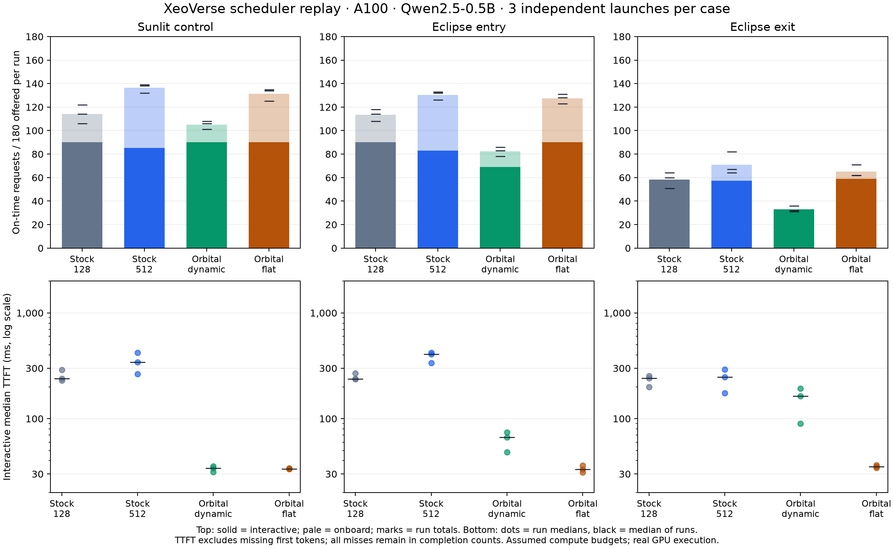
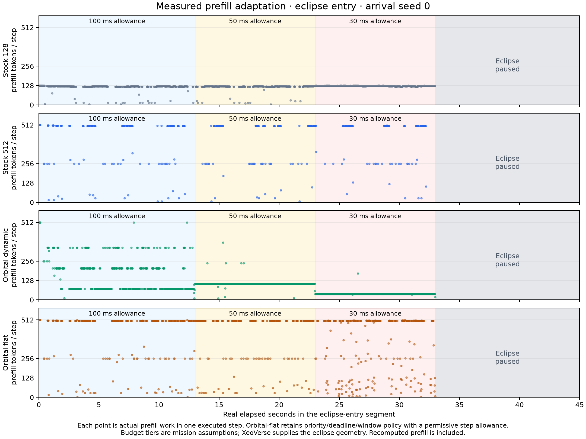

# XeoVerse scheduler comparison on A100

This campaign compares the existing orbital scheduler with immutable upstream
vLLM using XeoVerse orbital geometry and real GPU inference. The serving runtime
is unchanged from the earlier pilot. Only trace export, experiment orchestration,
and measurement tooling are extended.
Handoff and communication-selection features are inactive in this comparison.

## Results

The **36-run comparison completed on 2026-11-10**. Dynamic orbital scheduling
reduced interactive time to first token but completed fewer requests before
their deadlines than either stock batch size in all three scenarios.
This study does **not** establish an overall performance advantage for the
current dynamic resource policy.



Counts below sum three paired runs: **270 interactive and 270 onboard requests**,
540 total, per row. TTFT is the median of the three per-run interactive medians,
conditional on receiving a first token. The final column discloses how many
interactive requests received one. Missing first tokens remain deadline misses.

| Segment | Configuration | Interactive on time / 270 | Onboard on time / 270 | Total on time / 540 | Interactive TTFT (ms) | First-token observations / 270 |
| --- | --- | ---: | ---: | ---: | ---: | ---: |
| Sunlit | Stock-128 | 270 | 72 | 342 | 238.8 | 270 |
| Sunlit | Stock-512 | 256 | 153 | 409 | 340.9 | 270 |
| Sunlit | Orbital dynamic | 270 | 45 | 315 | 34.0 | 270 |
| Sunlit | Orbital permissive | 270 | 124 | 394 | 33.5 | 270 |
| Eclipse entry | Stock-128 | 270 | 70 | 340 | 237.3 | 270 |
| Eclipse entry | Stock-512 | 249 | 142 | 391 | 408.3 | 269 |
| Eclipse entry | Orbital dynamic | 207 | 40 | 247 | 66.8 | 270 |
| Eclipse entry | Orbital permissive | 270 | 112 | 382 | 33.3 | 270 |
| Eclipse exit | Stock-128 | 175 | 0 | 175 | 240.5 | 184 |
| Eclipse exit | Stock-512 | 172 | 41 | 213 | 247.6 | 184 |
| Eclipse exit | Orbital dynamic | 99 | 0 | 99 | 163.7 | 183 |
| Eclipse exit | Orbital permissive | 177 | 18 | 195 | 35.0 | 183 |

Against Stock-512, dynamic orbital completed 23.0% fewer requests in sunlight,
36.8% fewer at eclipse entry, and 53.5% fewer at eclipse exit. Interactive median
TTFT decreased by 90.0%, 83.6%, and 33.9%, respectively. These are descriptive
comparisons of this workload and model, not general speedup estimates.

The permissive-allowance control retains orbital priority/deadline selection,
preemption, and closing-window prediction. Its much better results than the
dynamic case show that reducing the allowance is costly here. Its interactive
latency benefit persists without tight step budgets, while overall completions
remain below Stock-512. The study does not isolate priority, deadline ordering,
and preemption individually from one another.

## What the prefill traces demonstrate



For eclipse entry, seed zero, the maximum observed orbital prefill work per step
fell from **512 to 378 to 174 tokens** as the allowance changed from 100 to 50 to
30 ms. Its median decode work per executed step fell from **six to two to one**
tokens. This confirms the mechanism changes the actual work sent to the GPU.
It does not show that those reductions were necessary: both stock configurations
had zero observed step-allowance overruns across the main campaign.

The permissive orbital control had one 30.99 ms step against a 30 ms allowance.
The dynamic policy had no step-allowance overruns, but its eclipse-entry runs
straddled the actual closing boundary by 0, 4.69, and 3.51 ms. Permissive orbital
had 0, 0, and 3.65 ms; both guarded stock configurations had zero. A duration cap
at step start and a closing-time boundary are different checks. These whole-step
wall-time measurements do not establish a hard real-time guarantee.

## Why throughput fell

The strongest evidence is a mismatch between the additive cost model and
batched execution. In Stock-512's eclipse-entry seed-zero run, **971 steps decoding
eight sequences without prefill had a 22.01 ms median**. The profile predicted
**119.43 ms** for that work. Consequently, the dynamic scheduler unnecessarily
reduces decode concurrency even when the real batch fits the allowance.

The same profile can underestimate small prefill chunks. At eclipse entry,
one 21-token step was predicted to take 15.00 ms but took 20.73 ms and crossed
the boundary by 4.69 ms. Improving the model requires both batch-aware costs and
an accurate minimum step duration; simply lowering its safety factor is not
supported by these observations.

Preemption also caused real recomputation. Dynamic orbital performed 50–117
preemptions per eclipse-entry run, repeating 36,875–50,224 computed token positions.
Stock had zero preemptions and repeated work. The permissive orbital control
recomputed even more while achieving better throughput than dynamic orbital,
so recomputation alone is not a complete explanation of the performance gap.

The next justified changes are a cost model calibrated on mixed batches and
validated on held-out traces, followed by admission/preemption decisions that
account for lost KV work. The serving implementation was not changed during
this comparison. Whole-device energy is retained in the summary; this study
does not establish an energy-efficiency advantage.

## Protocol

- Upstream: `8f2ba935a5cb82f5fc231eea6b687a87443e88a6`.
- Orbital checkout: `ae83cf9bb7bdd64dc808b5016a441c9ae672c253`.
- Qwen/Qwen2.5-0.5B-Instruct revision
  `7ae557604adf67be50417f59c2c2f167def9a775`.
- One A100 80GB PCIe, TP=1, BF16, eager synchronous execution,
  no prefix caching, chunked prefill, eight active sequences, greedy generation,
  `VLLM_BATCH_INVARIANT=1`. The second GPU stays idle.
- 36 fresh engine launches: three orbital segments, three paired arrival seeds,
  and four configurations. Runs are serial, with seeded randomized ordering.
- Stock-128 and Stock-512 use unchanged upstream priority scheduling with the
  named maximum batch-token count and a separately calibrated closing guard.
- Orbital uses a 512-token maximum and the changing per-step allowance.
  Orbital-flat uses the same scheduler with a permissive step allowance;
  it retains priorities, deadlines, and prediction of the closing window.
- Every mode receives the same workload, priority metadata, external deadline
  cancellation, and pause/keep gate. Model loading, references, and warmup occur
  before the measurement clock starts.

Each 45-second run offers 180 requests. Ninety interactive requests have
256-token prompts, 32 output tokens, priority zero, and two-second deadlines.
Ninety onboard requests have 2,048-token prompts, 128 output tokens, priority one,
and eight-second deadlines. Arrivals are uniformly distributed from 0 to 31.5
seconds with fixed seeds 0, 1, and 2. All requests remain in the denominator,
including those that arrive during the closed interval.

## What comes from XeoVerse

The adapter uses XeoVerse's default hypothetical 144-satellite Walker fleet:
six planes, 24 satellites per plane, 550 km altitude, and 53-degree inclination.
The epoch is 2026-11-08 12:00 UTC. Satellite zero's SGP4 TEME position and the
existing Sun-direction routine feed a cylindrical Earth-shadow calculation.
The Earth radius is 6,378.137 km; penumbra is omitted. The numerical crossing
bracket is narrower than 1 ms; this is solver resolution, not physical accuracy.

The resulting eclipse exit is at epoch +1,714.2388 s and entry at +5,373.5034 s.
Three local segments replay at one orbital second per wall second:

| Segment | Start offset from epoch | Compute availability |
| --- | ---: | --- |
| Sunlit | 1,834.2388 s | 0–45 s |
| Eclipse entry | 5,340.5034 s | 0–33 s, then pause |
| Eclipse exit | 1,702.2388 s | Pause 0–12 s, then 12–45 s |

The mapping from sunlight to compute availability is an **assumed mission
policy**: pause inference in shadow while retaining weights and KV. Sunlight
alone does not imply this behavior for a real battery-equipped satellite.

A second explicit policy allocates steps up to 30 ms within ten seconds of the
shadow boundary, 50 ms at ten to twenty seconds, and 100 ms farther away. Both
stock configurations are evaluated against the same allowances. The cap at a
step's start is compared with measured whole-step duration; overruns remain
visible and are not discarded. No GPU power cap is applied. Power and energy
forecast ceilings are permissive; this is not a battery-efficiency experiment.

## Calibration correction retained as diagnostic evidence

The first launch used a 25 ms minimum allowance. Calibration estimated a
minimum decode step of about 26.9 ms including the safety factor, so that setting
would test deliberate decode deferral rather than useful prefill adaptation.
The launcher was stopped, the in-flight job allowed to finish, and the completed
runs retained separately. The main campaign uses 30 ms, approximately ten
percent above that calibrated estimate, with unchanged 50 and 100 ms tiers.
A runner check now refuses an allowance below the calibrated decode floor.
Diagnostic runs are excluded from the main comparison.

## Measurement and limits

All generated prefixes must match the exact greedy reference. Cross-mode
reference hashes are checked again during analysis. Step traces record actual
computed-token intervals, including completed requests and reset/preemption
steps. Recomputed work is overlap with positions already computed for that
request. Missing first tokens are reported through observation counts and misses;
TTFT percentiles are conditional on receiving a token.

This measures one local serving replica driven by orbital traces. The 144
simulated satellites are not 144 GPU measurements. It does not emulate network
transport, ground delivery, spacecraft thermal behavior, battery state, or
forecast error. It also does not compare production-tuned CUDA-graph or
asynchronous stock vLLM, larger models, or multiple offered-load levels.
Three paired arrival seeds provide descriptive replication, not broad
statistical guarantees. The priority/latency and onboard-throughput tradeoff
must be assessed together.

The fixed stock budgets are batch-token ceilings, not a claim that every stock
prefill chunk has the same size. Stock already implements chunked prefill and
continuous batching. The additional orbital behavior is conditioning the step's
work on a supplied time budget and deadline-aware policy.

## Reproduction

The commands and trace contract are in
[orbital_serving.md](../../docs/design/orbital_serving.md#xeoverse-scheduler-comparison).
The frozen plan records serving commits, harness hashes, and trace identities.
Each configuration has its own raw results, worker options, token outputs,
step log, and energy samples. The analyzer refuses incomplete campaigns unless
`--allow-partial` is explicitly requested.

## Retained evidence and validation

All generated prefixes matched their greedy references. Independent analysis
also verified all **6,480 saved request records**, including misses, against
complete outputs matching the recorded reference hashes. All 282 raw files
matched the remote SHA-256 inventory. **85 unique CPU component/harness tests
passed**; see the overlapping suite counts in
[validation.json](experiments/xeoverse-20261110/validation.json).
Both A100s were idle when the campaign completed.

- [Full numerical summary](experiments/xeoverse-20261110/summary.json), including
  per-seed outcomes, first-token observation counts, preemptions, repeated work,
  measured device energy, and prediction-versus-observation statistics.
- [Frozen plan](experiments/xeoverse-20261110/plan.json) and
  [hardware/runtime identity](experiments/xeoverse-20261110/environment.json).
- [Main raw-data archive](experiments/xeoverse-20261110/campaign-v2.tar.gz):
  all 36 scheduler runs, both calibrations, token records, step logs, options,
  forecasts, worker logs, and a raw-file checksum inventory.
- [Initial diagnostic archive](experiments/xeoverse-20261110/campaign-v1.tar.gz)
  and [stop record](experiments/xeoverse-20261110/diagnostic_stop.json).
- [Exact main harness](experiments/xeoverse-20261110/harness-v2.tar.gz) and
  [initial harness](experiments/xeoverse-20261110/harness-v1.tar.gz).
- [XeoVerse geometry and source hashes](experiments/xeoverse-20261110/traces-v2/geometry.json).
  Exported traces suffice to replay GPU inference without regenerating geometry.
  An exact local snapshot of the 29 XeoVerse source files is identified in the
  validation record; it is separate from the vLLM fork.

To regenerate the summary and plots from the archived measurements:

```bash
mkdir -p /tmp/xeoverse-data
# Run from the vLLM fork root.
tar -xzf benchmarks/satellite/experiments/xeoverse-20261110/campaign-v2.tar.gz \
  -C /tmp/xeoverse-data
.venv/bin/python benchmarks/satellite/analyze_xeoverse_scheduler.py \
  /tmp/xeoverse-data/campaign-v2 --output /tmp/xeoverse-summary.json
MPLCONFIGDIR=/tmp/orbital-matplotlib .venv/bin/python \
  benchmarks/satellite/plot_xeoverse_scheduler.py \
  /tmp/xeoverse-data/campaign-v2 /tmp/xeoverse-summary.json /tmp/xeoverse-figures
```

Matplotlib is required only for plotting. The analysis checks the frozen plan,
source identities, calibrations, workload denominators, generation limits,
harness identities, and outputs before producing a complete summary.
