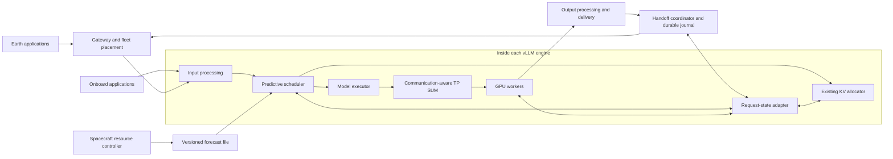

# Orbital serving engine

Orbital serving is an experimental, opt-in extension for inference under
changing compute budgets and communication conditions. Enable the predictive
scheduler with `scheduler_cls="vllm.satellite.scheduler.SatelliteScheduler"`
and `additional_config["orbital"]`. Enable communication selection separately
with `additional_config["orbital_communication"]`. Both are disabled by default.
Ordinary vLLM retains its scheduling and communication behavior.

This branch implements resource scheduling, durable ownership and request replay,
compatible KV images, and collective selection. Validation on two A100 80GB PCIe
GPUs passed eight real-model tests, including independent-process handoffs by
recomputation and KV transfer. A 64-question GSM8K comparison matched stock
accuracy. See the [validation report](https://github.com/mkassemio/vllm/blob/codex/orbital-serving-engine/benchmarks/satellite/VALIDATION.md)
for the environment, measured overhead, regression results, and limitations.
The [collective optimization report](https://github.com/mkassemio/vllm/blob/codex/orbital-serving-engine/benchmarks/satellite/OPTIMIZATION.md)
records repeated stock comparisons and the dispatch/copy changes on A100 GPUs.
This is not a flight-ready deployment.

## Architecture

The fleet planner supplies placement and versioned resource forecasts. Each
engine contains a predictive scheduler, a request-state adapter, and a
communication-aware execution policy. A coordinator owns the durable journal
outside the engine. Earth applications enter through a gateway; onboard
applications can submit locally without ground connectivity.



The gateway, orbit/contact prediction, thermal and battery telemetry, physical
radio transport, placement, authentication, and spacecraft protection are
external integrations. This implementation consumes their budgets and decisions.
Onboard image or sensor pipelines must currently convert their task to supported
text-token inputs; multimodal model recovery is not implemented.

The predictive policy runs before KV allocation. The existing allocator owns
physical blocks. Generated tokens, computed tokens, and delivered tokens are
separate positions. A request handoff freezes its source, prepares a destination,
and commits a new ownership generation before destination execution starts.

Every distributed rank must execute the same collective sequence under the same
plan version. A failed collective fails the execution group; individual ranks
must not independently switch algorithms after a failure.

## Contracts

- Forecast time is Unix seconds. Local time progression uses a monotonic anchor.
- Power is watts; energy is joules. Limits describe the inference payload's
  available allocation, after spacecraft reserves.
- Windows are ordered, nonoverlapping, and half-open. Missing, expired, invalid,
  or regressing forecasts prevent admission.
- A forecast's energy is the remaining allocation at its issue time. The engine
  charges reservations overlapping that issue time; repeated reads or a changed
  version do not replenish it. An overlapping step is charged in full.
- After engine startup or restart, publish a forecast issued at or after
  `engine_started_s`. A forecast from a previous process cannot reset its energy
  allowance. Forecast versions and issue times may not regress within a process.
- Cost profiles are calibrated estimates with a safety factor. They do not prove
  worst-case execution time or replace spacecraft hardware protection.
- Requests retain their model revision, token history, generation limits, and
  supported sampling state across recovery.
- At-least-once transport uses idempotent handoff messages and ordered output
  records. It does not promise exactly-once network delivery.

## Implementation milestones

1. Fork, immutable upstream baseline, contracts, and CPU policy tests.
2. Scheduler integration before allocation and accounting changes.
3. Durable replay snapshots, ownership, cancellation, and output fencing.
4. Compatible KV export/import with transactional handoff.
5. Calibrated collective selection and coordinated execution changes.
6. Combined fault scenarios through real serving entry points.
7. Numerical evaluation, performance attribution, and reproducible documentation.

Initial support targets synchronous dense decoder inference and compatible
replicas. Additional sampling, cache, and parallel layouts need explicit
validation. Unsupported combinations must be rejected rather than silently
treated as supported.

## Enable the scheduler

Use the fork's normal installation instructions on a supported Linux GPU host.
The scheduler requires synchronous execution, PP=1, DP=1, full-attention cache
groups, text inputs, and no speculative decoding or external KV/EC connectors.
TP is permitted. Independent replicas are coordinated outside engine DP.

```python
from vllm import LLM

llm = LLM(
    model="Qwen/Qwen2.5-0.5B-Instruct",
    enforce_eager=True,
    async_scheduling=False,
    scheduler_cls="vllm.satellite.scheduler.SatelliteScheduler",
    additional_config={
        "orbital": {
            "node_id": "satellite-1",
            "forecast_path": "/run/orbital/forecast.json",
            "profile": {
                "fixed_step_s": 0.002,
                "prefill_token_s": 0.001,
                "decode_token_s": 0.003,
                "power_w": 100.0,
                "safety_factor": 1.2,
            },
            "guard_s": 0.01,
            "aging_s": 30.0,
        }
    },
)
```

These profile values illustrate the schema; they are not GPU measurements.
Calibrate them for the model, batch shapes, clock settings, and TP routes before
evaluating resource feasibility. Thermal constraints are supplied as safe power,
energy, and operating-window limits, not interpreted from raw temperatures.

After the engine initializes, the resource controller atomically replaces the
forecast. A minimal format example, with illustrative budgets:

```python
import json
import os
import time
from pathlib import Path

path = Path("/run/orbital/forecast.json")
path.parent.mkdir(parents=True, exist_ok=True)
now = time.time()
forecast = {
    "version": 1,  # Increase for every change within an engine session.
    "issued_s": now,
    "expires_s": now + 60,
    "windows": [{
        "start_s": now,
        "end_s": now + 60,
        "max_power_w": 150,
        "energy_j": 3000,
        "max_step_s": 0.2,
        "max_tokens": 32,
        "max_requests": 8,
    }],
}
temporary = path.with_suffix(".tmp")
temporary.write_text(json.dumps(forecast))
os.replace(temporary, path)
```

Only one controller writes each file. Time is UTC Unix seconds; engine clock
progress is anchored to a monotonic clock. Clock synchronization between the
controller and engine is a deployment requirement. A malformed, expired, missing,
pre-startup, or regressing forecast pauses compute admission. Requests remain
cancellable. Deadline expiry produces `orbital_deadline_exceeded`.

Per-request deadlines use
`SamplingParams(extra_args={"orbital": {"deadline_s": unix_seconds}})`.
Priority follows vLLM's convention: lower values come first. Aging adjusts
priority; the tightest selected deadline limits the entire batch. Quotas are
applied before block allocation and progress updates. A frozen handoff request
retains its KV and is not expired by its local scheduler until resumed.

The policy bounds the next synchronous batch using calibrated estimates. It
does not promise whole-request completion, global constellation optimization,
or a hardware power cap. Incorrect forecasts or underestimated execution costs
can still miss deadlines. Reservations are conservatively charged even if
memory pressure prevents part of the planned batch from running.

## State, replay, and handoff

`StateJournal(path)` uses SQLite WAL and full synchronous transactions as one
durable authority. Do not copy its database to independent satellites and treat
those copies as consensus. During an authority outage, defer ownership changes.
The authority can run onboard a designated node; it need not be on Earth.

`HandoffCoordinator(journal, endpoints)` accepts trusted endpoint functions with
the signature `(command, payload) -> dict`. The engine client provides
`orbital_control(command, payload)` and its async equivalent. For a synchronous
client, `client.orbital_control` is directly usable as an endpoint. Serialize
control calls with ingress and output handling for in-process engines; the
multiprocess client's utility queue executes commands between completed steps.

```python
from vllm.satellite.handoff import HandoffCoordinator
from vllm.satellite.state import StateJournal

journal = StateJournal("/var/lib/orbital/requests.sqlite")
coordinator = HandoffCoordinator(journal, {
    "source": source_client.orbital_control,
    "target": target_client.orbital_control,
})
journal.register(request_id, "source")
# Commit generated history before delivering it to clients.
coordinator.publish(request_id, "source", 0, tuple(generated_tokens))
owner = coordinator.start("unique-handoff-id", request_id, "target",
                          mode="recompute")  # Or "transfer" for compatible KV.
# A lost response is retried with the same handoff ID.
owner = coordinator.advance("unique-handoff-id")
```

The protocol freezes the source, persists its snapshot and output history,
prepares an inactive destination, records readiness, commits an ownership
generation, activates the destination, then retires the source. Before commit,
`abort(handoff_id)` discards the destination and resumes the source with a new
generation. After commit, an abort is forbidden. A failed RPC does not trigger
an automatic rollback. Retry the durable decision. A failed destination process
can replay the original snapshot plus subsequently committed output history.

Output records carry owner, generation, and token offset. Stale owners and
conflicting duplicate output are rejected. Clients resume with
`journal.tokens(request_id, after=offset)`. This is ordered, replayable output,
not exactly-once network delivery. All migrating request output must go through
this authority; the engine alone does not fence an existing HTTP connection.
Pass `finished=True` to `coordinator.publish` for terminal output so its final
tokens and completion are committed in one transaction. The application calls
`journal.cancel` before sending aborts to every involved engine. Cancellation
fences output durably even if an engine is unreachable.

Cross-engine frontend routing, detokenizer/HTTP session migration, automatic
failure detection, checkpoint cadence before the first handoff, and replicated
authority failover remain external work. There is no claim of seamless
migration for an existing OpenAI streaming response. A token-based gateway can
use the control and journal APIs directly. A lost source before any durable
snapshot requires application retry from its original input.

Recovery currently requires greedy decoding and none of the following:
penalties, string stops, minimum-token constraints, logprobs, speculative state,
LoRA, custom processors,
watermarking, structured output, or resumable inputs. Unsupported requests are
rejected before capture. Original prompt tokens and generated tokens remain
separate; replay never resets the output-token limit. Model fingerprints include
an immutable resolved revision or local weight-file digests, model config,
precision, and quantization.

KV transfer additionally requires one full-attention cache group, matching TP
rank layout, unquantized FP32/FP16/BF16 caches, and standardized
`[blocks, heads, tokens, channels]` views whose block size matches the manager.
Images use safetensors, SHA-256, strict layer/shape/dtype checks, and a 256 MiB
per-rank payload budget plus bounded metadata. Uncomputed tails are zeroed.
The destination reserves exclusive inactive blocks; every rank must finish
import before readiness. Failed imports remain inactive. This is a bounded
control-plane transfer path, not a streaming DTN bulk-transfer implementation.

`RecoveryCosts(keep_s, transfer_s, recompute_s).choose(remaining_s)` selects the
least-cost feasible action or `wait`. Supply measured or modeled costs; the
class does not estimate intersatellite bandwidth or predict orbit contacts.

## Communication-aware execution

The executor intercepts eager TP SUM calls. It selects native distributed
all-reduce, direct all-peer exchange, or native all-gather plus local summation.
Direct and all-gather reductions accumulate FP16/BF16 in FP32 in fixed rank
order. They implement SUM without compression, but their rounding can differ
from NCCL. Direct exchange sends `(TP - 1) * message_bytes` per rank; shared
links and large messages can make it slower than native collectives.

CUDA engines reuse vLLM's PyNCCL communicator when available. Grouped sends and
receives execute on the caller's CUDA stream, followed by local addition on that
same stream. For TP=2, direct exchange receives only the peer's contribution and
uses one binary addition; it avoids copying its own input and materializing
FP32 conversion buffers. The binary sum retains the original single-rounding
semantics for FP16/BF16. Larger groups retain rank-ordered FP32 accumulation.
Results are out of place and inputs are preserved.

Measure the actual group before choosing costs:

```bash
torchrun --standalone --nproc-per-node=2 \
  benchmarks/satellite/calibrate_collectives.py \
  --backend nccl --transport pynccl --output /tmp/collective-costs.json
```

The report includes measured median and p95 times and a conservative linear fit
over the measured sizes. Supply its `plan` object as
`additional_config["orbital_communication"]`. Each cost has `name`, `latency_s`,
and `seconds_per_byte`; plans also require increasing `version`, `world_size`,
and `max_scratch_bytes`. Native must be present. The lowest estimated cost wins,
subject to the extra-scratch limit. Backend-internal native scratch is excluded.
Remeasure when routes, group membership, dtype, contention, or GPU clocks change.
Use `--transport pynccl` to measure the CUDA engine's PyNCCL path, or
`--transport torch` to measure the c10d fallback. The latter is also the only
transport for Gloo. `--profile-dir` additionally records per-rank Chrome traces
and operator summaries after each case's timed iterations; profiler timings must
not be interpreted as uninstrumented latency.

After communicators are constructed, all ranks agree the full plan and transport
before use. Transport disagreement fails orbital plan installation; a transport
disabled after agreement raises an error rather than switching one rank to c10d.
Synchronous, eager, PP=DP=1 execution
is required. Between steps, the EngineCore utility
`orbital_update_communication(plan)` updates every worker collectively; a
mismatched update fails on all participating ranks without installing it.
`collective_rpc("orbital_communication_statistics")` returns the transport and
per-rank call and payload counts. A failed collective fails the group: never switch algorithms
on one rank and continue. Group resizing, parameter reshards, changing attention
replication, CUDA graphs, and transparent recovery from broken NCCL groups are
not implemented in this branch.

## Evaluation

Compare stock vLLM, stock plus the same fleet router, scheduler, scheduler plus
state manager, and all three components. Match hardware, model revision, input
traffic, network traces, and resource limits. Include stale or inaccurate
forecasts, shared-link contention, and handoff overhead. Report deadline goodput,
first-token latency, token gaps, recovery delay, transferred bytes, and wasted
computation. Report modeled resource use separately from measured hardware use.

Run pure policy tests without initializing the GPU stack:

```bash
.venv/bin/python -m pytest --confcutdir=tests/satellite tests/satellite -q
```

CUDA execution and multi-GPU validation require a Linux CUDA host. Passing pure
policy tests is not evidence that GPU serving or KV transfer is correct.

The local suite also includes actual scheduler/allocator objects, SQLite process
reopen and ownership races, replay metadata, tensor KV remapping, RPC-loss
injection around real adapters, and two real Gloo processes. On macOS, set
`GLOO_SOCKET_IFNAME=lo0` if hostname resolution cannot identify loopback.

The CUDA gates are wired into `.buildkite/test_areas/engine.yaml`:

```bash
# One GPU: stock-vs-predictive LLM and replay/KV continuation.
.venv/bin/python -m pytest tests/satellite_gpu/test_serving.py -v
# Two GPUs: numerical comparison and handoff between independent engines.
.venv/bin/python -m pytest \
  tests/satellite_gpu/test_tensor_parallel.py \
  tests/satellite_gpu/test_handoff.py -v
# Run accuracy comparisons separately on the same host.
PYTHONPATH=. .venv/bin/python benchmarks/satellite/evaluate_gsm8k.py \
  --mode stock --output /tmp/gsm8k-stock.json
PYTHONPATH=. .venv/bin/python benchmarks/satellite/evaluate_gsm8k.py \
  --mode orbital --output /tmp/gsm8k-orbital.json
```

These tests use real Qwen model weights, assert continued generation limits,
compare to stock vLLM, and check that the selected communicator actually ran.
The handoff tests consume EngineCore outputs through the journal; they do not
test migration of an existing HTTP connection or frontend session.
No CPU result substitutes for running them. Record the GPU model, drivers,
PyTorch/CUDA/NCCL versions, model revision, traces, and branch SHA with results.

For repeated comparisons, add `--warmup-runs 1 --repeats 3` to each evaluation
command. Modes `scheduler` and `communication` isolate the two sources of
overhead, while `orbital` enables both. Run configurations sequentially on an
otherwise idle host with identical arguments. Reports preserve each measured
run and its accuracy, as well as median latency and throughput. These defaults
compare eager TP=2 execution with custom all-reduce disabled; they do not compare
against stock vLLM's fastest possible CUDA-graph configuration.

### Scheduler and handoff experiment harness

`benchmarks/satellite/run_experiments.py` runs real, isolated TP=1 GPU engines.
Pass `--source` to select an immutable upstream checkout or the orbital fork.
The same worker program and installed CUDA dependencies serve both checkouts;
each artifact records the imported vLLM location, source commit, model revision,
engine options, harness hashes, and raw measurements. Check that generated wheel
wrappers and compiled extensions are present in both source trees before running.

```bash
PYTHONPATH=. .venv/bin/python benchmarks/satellite/run_experiments.py calibrate \
  --source /path/to/upstream --output /tmp/orbital-calibration
PYTHONPATH=. .venv/bin/python benchmarks/satellite/run_experiments.py make-trace \
  --scenario windows --seed 0 --output /tmp/orbital-trace.json
PYTHONPATH=. .venv/bin/python benchmarks/satellite/run_experiments.py scheduler \
  --source /path/to/orbital --mode orbital --trace /tmp/orbital-trace.json \
  --calibration /tmp/orbital-calibration/result.json \
  --output /tmp/orbital-scheduler-run
PYTHONPATH=. .venv/bin/python benchmarks/satellite/run_experiments.py handoff \
  --source /path/to/orbital --mode transfer --context 2048 \
  --output /tmp/orbital-handoff-run
```

The scheduler trace schema contains `schema_version: 1`, `duration_s`, disjoint
`windows` of `[start_s, end_s]`, and `requests`. Each request contains a unique
`id`, relative `arrival_s` and `deadline_s`, positive `prompt_tokens` and
`output_tokens`, integer `priority`, and `class` (`interactive` or `onboard`).
Every deadline must fall within the measurement horizon. Relative timestamps
are mapped once to host monotonic time and the engine's Unix-time forecasts.
Optional `step_limits` entries contain `start_s`, `end_s`, and `max_step_s`.
They must partition all open compute time, with positive finite duration caps.
The `make-trace` command generates synthetic availability. The XeoVerse adapter
below derives availability from orbital geometry and an explicit mission policy.
The harness does not integrate XeoVerse network emulation.

Scheduler modes are `stock`, `stock_guard`, `orbital`, and `orbital_flat`. All receive identical
open-loop arrivals and priority metadata and share the same external gate: no
new step is requested in a closed window, and existing KV remains resident.
`stock_guard` also stops requesting steps near a window's end using a calibrated
p99 duration plus margin. Orbital additionally uses its batch-level policy and
deadline metadata. Both stock modes cancel expired requests externally. Steps
that straddle window boundaries are measured, not silently discarded. This
gate is an in-process equivalent of pause/keep, not an HTTP pause benchmark.
`orbital_flat` retains orbital priorities, deadlines, and window prediction but
uses a permissive ten-second step allowance instead of trace `step_limits`.
This ablation isolates the changing per-step allowance, not all forecasting.

All offered requests remain in deadline-goodput denominators. Token timestamps
record actual gateway receipt of chunks; first-token percentiles disclose their
observation counts and exclude requests with no first token. Generated prefixes
must exactly match unbatched greedy references under `VLLM_BATCH_INVARIANT=1`.
Whole-GPU energy counter deltas include idle GPU power during closed windows;
their sampling boundaries are retained. These are distinct from the profile's
illustrative `power_w=100` and do not establish battery savings or a power cap.

Handoff modes are `wait`, `restart`, `stock_replay`, `recompute`, and `transfer`.
Both replicas have resident weights and use separate physical GPUs. All modes
commit tokens to the same SQLite journal before recording delivery. Stock replay
supplies the original prompt plus delivered tokens and preserves the remaining
output allowance. Restart suppresses already delivered tokens and verifies that
the regenerated prefix agrees. Orbital additionally checks stale-owner fencing
and idempotent retry after completion. Every run requires exact continuation and
the original total output limit. Three repetitions within one engine pair are
request repetitions, not three independent engine launches.
The trigger begins a planned inference suspension: the source remains reachable
for state export. It is not an instantaneous loss of GPU power. `wait` resumes
source inference after `--outage-s`; other modes move the request immediately.
`--fault lost_activate_reply` deliberately discards a successful destination
activation response, retries the durable decision, and requires the same exact
continuation. Use this separately from the no-fault timing campaign.

The reported handoff gap includes checkpoint, local IPC serialization, GPU
copies, journal operations, and destination execution. KV payload bytes count
the image once, not every control message. No network delay is injected: this
is a warm-replica local-transport measurement, not an intersatellite-link result.
Authority partition, abrupt source loss, cold model loading, and HTTP session
migration are outside this pilot. Images remain subject to the 256 MiB/rank cap.

`run_campaign.py` runs paired scheduler traces in seeded randomized order, then
a context-length handoff sweep. It checks for foreign GPU processes, takes a
cooperative GPU lease, launches jobs serially, stops on errors, and records a
plan and progress file. Output directories cannot be overwritten. `--resume`
only skips completed results from the same plan; incomplete attempts must be
inspected separately. Resume also checks source commits, harness hashes,
calibration contents, and regenerated traces. Its default pilot has 18 fresh scheduler launches and
11 handoff configurations, each with three requests in one fresh engine pair.
All configurations use eager synchronous execution. Production-tuned stock,
larger models, shaped links, uncertain forecasts, and larger paired campaigns
remain separate follow-up experiments.

`summarize_experiments.py ROOT --output summary.json` validates paired trace,
calibration, and greedy-reference hashes before aggregating results. Missing
latency and energy stay null. Per-run completion counts and handoff ranges
remain visible. `plot_experiments.py summary.json pilot.png` exports a figure
using matplotlib, which is only needed in the analysis environment. Scheduler
step logs also expose repeated prefill after decoding. The original pilot's
excess-prefill metric is a lower bound. New logs retain completed request
objects, preemption events, and computed-token start offsets, allowing the
XeoVerse analyzer to count overlap with previously computed token positions.

### XeoVerse scheduler comparison

`xeoverse_trace.py` uses the supplied XeoVerse checkout's Walker constellation,
SGP4 propagator, and Sun direction. It selects 45-second sunlit, eclipse-entry,
and eclipse-exit segments for satellite zero. The export records source hashes,
positions, numerical transition brackets, and a one-to-one orbital/wall clock.
Its cylindrical Earth-shadow approximation omits penumbra. The modeled fleet
has 144 satellites; the experiment measures one TP=1 serving replica on an A100.

Inference pauses in shadow and keeps resident KV under an **assumed mission
policy**. In sunlight, the step allowance is 30 ms within ten seconds of eclipse,
50 ms at ten to twenty seconds, and 100 ms farther away. These are supplied
compute-slot budgets, not a validated battery, thermal, or spacecraft power model.
Stock is measured against the same budgets; the harness reports overruns rather
than silently removing expensive steps. No hardware power limit is changed.

```bash
# Use the XeoVerse environment for geometry export.
/path/to/xeoverse/.venv/bin/python benchmarks/satellite/xeoverse_trace.py \
  --xeoverse /path/to/xeoverse --output /tmp/xeoverse-traces
# Use the Linux CUDA environment for actual inference.
PYTHONPATH=. .venv/bin/python benchmarks/satellite/run_xeoverse_scheduler.py \
  --stock /path/to/upstream --orbital /path/to/orbital \
  --traces /tmp/xeoverse-traces --output /tmp/xeoverse-campaign
.venv/bin/python benchmarks/satellite/analyze_xeoverse_scheduler.py \
  /tmp/xeoverse-campaign --output /tmp/xeoverse-summary.json
```

The runner calibrates each batch size, checks that the minimum allowance can
fit an estimated decode step, then runs 36 serial fresh-engine comparisons:
three scenarios, three arrival seeds, and four configurations. Stock uses its
unchanged priority scheduler with chunked prefill at 128 or 512 batch tokens;
both receive the calibrated closing guard. Orbital and `orbital_flat` use 512.
Loading, reference generation, and warmup precede each measurement window.
All offered requests, including arrivals during eclipse, remain in the results.

The analyzer checks the frozen plan, trace, serving commit, calibration, harness,
and cross-mode greedy-reference identities. Incomplete campaigns fail analysis
unless explicitly marked `--allow-partial`. Metrics include per-class deadline
completions, conditional TTFT and observation counts, actual prefill chunk sizes,
preemptions, repeated computed-token work, device energy, and budget overruns.
The step-duration cap is evaluated at the actual start of each executed step;
whole-step wall time includes CPU scheduling and GPU execution. It is not an
isolated CUDA kernel duration or a hard real-time guarantee.

The measured 36-run A100 comparison, including the latency/throughput tradeoff,
cost-model diagnosis, and raw-data archives, is documented in
[XeoVerse scheduler results](../../benchmarks/satellite/XEOVERSE_SCHEDULER.md).
